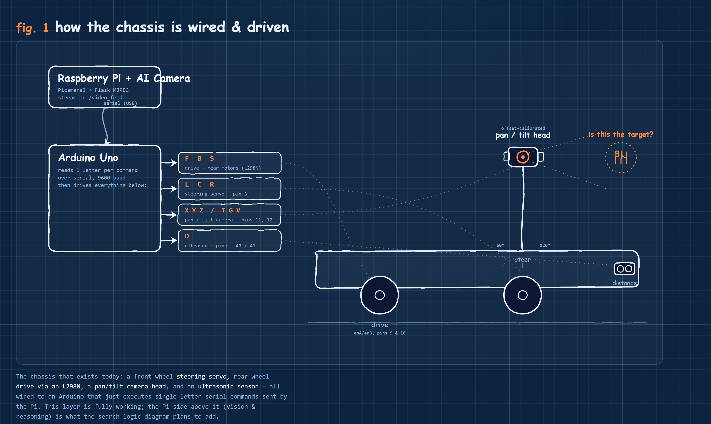
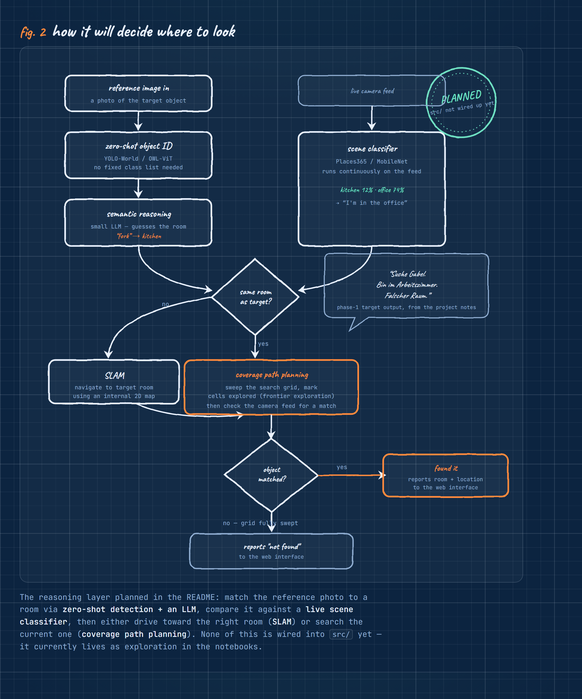

# Auto Tracker Bot 

Ein autonomes Fahrzeug auf Basis von Raspberry Pi und Arduino, das mittels One-Shot-Learning über eine Kamera nach einem vorgegebenen Referenzbild sucht.

## Systemarchitektur

*   **Arduino :** Empfängt serielle Steuerbefehle und steuert die Motortreiber (L298N).
*   **Raspberry Pi :** Führt Computer Vision via Kamera aus, berechnet Wegpunkte und sendet Navigationsbefehle an den Arduino.

## 🗺️ Projektphasen & Roadmap

# Architektur-Konzept: Auto-Tracker-Bot

Dieses Dokument beschreibt die modulare Architektur und den stufenweisen Entwicklungsplan für den autonomen Tracking-Roboter. Das System kombiniert maschinelles Sehen (Raspberry Pi AI Camera) mit logischem Schlussfolgern (Semantic Reasoning) und autonomer Navigation (SLAM).

---

## 1. Kernmodule der Architektur

Das System wird in drei isolierte Hauptmodule unterteilt, um die Hardware-Ressourcen des Raspberry Pi optimal zu nutzen und die Fehleranfälligkeit zu minimieren.

### 1.1 Semantisches Mapping (Was wird gesucht und wo gehört es hin?)
Sobald ein Referenzbild übergeben wird, muss das System den Gegenstand identifizieren und logisch verknüpfen.
* **Objekterkennung (Zero-Shot Detection):** Einsatz von Open-Vocabulary-Modellen (z.B. YOLO-World oder Owl-ViT). Diese Modelle erfordern kein starres Training auf bestimmte Klassen, sondern können Objekte anhand eines Text-Prompts oder Referenzbildes dynamisch im Raum finden.
* **Logische Verknüpfung:** Nutzung einer API (z.B. OpenAI) oder eines kleinen, lokalen LLMs (Large Language Model), um den Kontext des Objekts zu bestimmen (z.B. `Gabel -> Küche`).

### 1.2 Raumklassifikation (Wo befindet sich das System?)
Die Kamera bewertet kontinuierlich die aktuelle Umgebung, um den Raumtyp zu identifizieren.
* **Scene Classification:** Ein Bildklassifizierungsmodell (z.B. ResNet oder MobileNet, trainiert auf Datensätzen wie *Places365*).
* **Entscheidungslogik:** Das Modell analysiert den Kamera-Feed und liefert Wahrscheinlichkeiten (z.B. `Küche: 85%, Wohnzimmer: 10%`). Ein logischer Abgleich entscheidet anschließend: *Entspricht der Ist-Raum dem Soll-Raum?*

### 1.3 Autonome Navigation (Bewegung und systematische Suche)
Die Steuerung des Fahrwerks und die Orientierung im Raum.
* **Raumwechsel (SLAM):** Falls sich das Fahrzeug im falschen Raum befindet, nutzt es SLAM (Simultaneous Localization and Mapping) zur Orientierung und Navigation in andere Räume. Dies erfordert eine interne 2D-Karte.
* **Systematische Suche (Coverage Path Planning):** Befindet sich das Fahrzeug im korrekten Raum, wird ein Suchraster abgefahren. Das System markiert intern bereits durchsuchte Bereiche (Frontier Exploration), um keinen Winkel auszulassen.
* **Fehler-Reporting:** Wird das Objekt nach vollständigem Scan nicht gefunden, sendet das System eine entsprechende Meldung an das Web-Interface.

---

## 2. Entwicklungsplan (Minimum Viable Product)

Um Abhängigkeitsprobleme bei der Integration zu vermeiden, wird das Projekt schrittweise von einer stationären Logik hin zur vollautonomen Bewegung entwickelt.

### Phase 1: Stationäre Logik (Ohne Fahrgestell)
> **Status:** in `notebooks/03_one_shot_cv.ipynb` skizziert, noch nicht in `src/main.py` verdrahtet.

Das Fahrzeug verbleibt stationär. Der Fokus liegt rein auf der Software-Pipeline der Bildverarbeitung.
1. Einlesen des Referenzbildes.
2. Logische Bestimmung des vermuteten Zielraums.
3. Abgleich mit der aktuell sichtbaren Umgebung.
4. *Output-Ziel:* Terminal-Ausgabe wie z.B. `"Suche Gabel. Bin im Arbeitszimmer. Falscher Raum."*

### Phase 2: Visuelles Tracking (Beweglicher Kopf)
> **Status:** Hardware fertig — Pan- (Pin 11) und Tilt-Servo (Pin 12) montiert und offset-kalibriert.

Erweiterung der stationären Logik um gezielte Motorsteuerung für die Kamera.
1. Montage der AI-Kamera auf Servomotoren (Pan/Tilt).
2. Systematisches visuelles Abscannen der unmittelbaren Umgebung, ohne die Position des Fahrzeugs zu verändern.

### Phase 3: Autonome Fahr-Logik (SLAM & Wegpunkte)
> **Status:** Lenkung, Antrieb & Ultraschallsensor sind am Arduino verdrahtet — SLAM-Software noch nicht begonnen.

Integration der Motorsteuerung für das Fahrwerk.
1. Implementierung von SLAM für die Orientierung.
2. Abfahren von errechneten Wegpunkten im Raum.
3. Hinderniserkennung und -vermeidung.
4. Finale Verknüpfung: Wenn die Kamera einen relevanten Bereich ausmacht, steuert das Fahrwerk gezielt dorthin.
